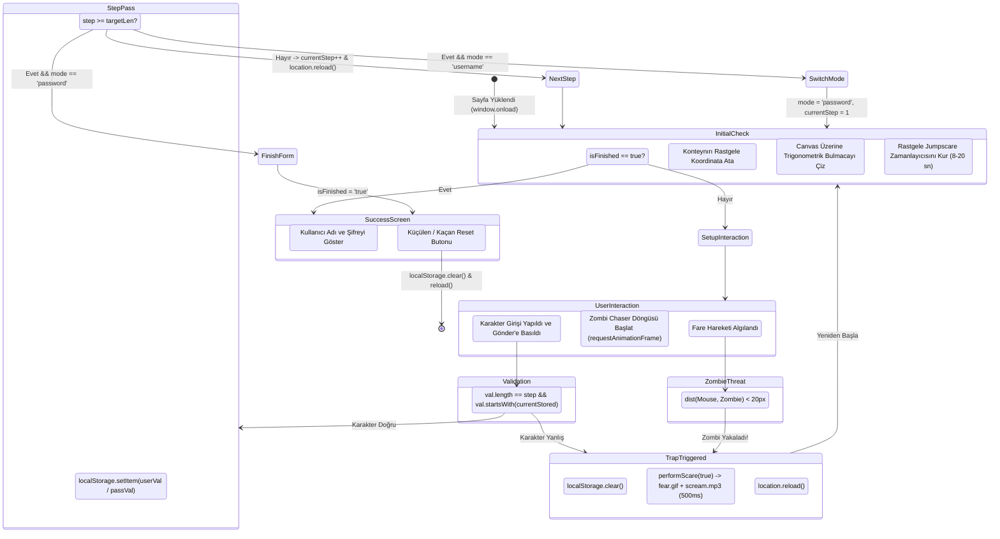

<div align="center">

# The Worst Login Form Ever (UltraSecure Portal / GRAVEYARD PASS)

> **Kullanıcı Deneyimi (UX) Anti-Pattern'lerinin, Düşmanca Arayüz Tasarımının (Hostile UI) ve Psikolojik Dayanıklılık Testlerinin Zirve Noktası.**

[](https://github.com/HakanURAL06/The-Worst-Login-Form-Ever)
[](script.js)
[](index.html)
[](style.css)
[](#akademik-baglam)
[-brightgreen?style=for-the-badge)](#mimari-ve-teknoloji-yigini)
[](#gelistirici-bilgileri)

</div>

---

## 📑 İçindekiler (Table of Contents)

- [1. Hero Bölümü](#the-worst-login-form-ever-ultrasecure-portal--graveyard-pass)
- [2. Problem Tanımı, Felsefe ve Çözüm Yaklaşımı](#problem-tanimi)
  - [Akademik Bağlam & Çıkış Noktası](#akademik-baglam)
  - [Düşmanca Arayüz (Hostile UX) Felsefesi](#hostile-ux-felsefesi)
- [3. Temel Özellikler (Key Features)](#temel-ozellikler)
- [4. Sistem Mimarisi ve Teknoloji Yığını (Architecture & Tech Stack)](#mimari-ve-teknoloji-yigini)
  - [Bileşen & Teknoloji Matrisi](#teknoloji-matrisi)
  - [Sistem Durum ve Akış Şeması (State Machine)](#durum-ve-akis-semasi)
- [5. Proje Klasör Yapısı (Project Structure)](#proje-klasor-yapisi)
- [6. Veri Modeli ve Durum Yönetimi (LocalStorage Schema)](#veri-modeli-ve-durum-yonetimi)
- [7. Kurulum ve Çalıştırma Rehberi (Getting Started)](#kurulum-ve-calistirma)
  - [Ön Gereksinimler](#on-gereksinimler)
  - [Adım Adım Çalıştırma](#adim-adim-calistirma)
- [8. Yol Haritası ve Katkıda Bulunma (Roadmap & Contributing)](#yol-haritasi-ve-katkida-bulunma)
- [9. Geliştirici Bilgileri ve Akademik Beyan](#gelistirici-bilgileri)

---

<a id="problem-tanimi"></a>
## 🎯 Problem Tanımı, Felsefe ve Çözüm Yaklaşımı

<a id="akademik-baglam"></a>
### Akademik Bağlam & Çıkış Noktası
Bu çalışma, **YBSB2008 Web Tasarımı** dersi kapsamında **Doç. Dr. Elif KARTAL** danışmanlığında geliştirilmiş kavramsal ve fonksiyonel bir web kimlik doğrulama arayüzüdür. Temel amaç, modern webin yerleşik kullanıcı deneyimi normlarını bilinçli bir biçimde ihlal ederek kullanıcıyı psikolojik, görsel ve fiziksel olarak sınayan *Düşmanca Arayüz (Hostile UI / Anti-User Design)* yaklaşımını deneysel bir projeyle ortaya koymaktır.

<a id="hostile-ux-felsefesi"></a>
### Düşmanca Arayüz (Hostile UX) Felsefesi
Geleneksel web geliştirme ilkeleri "Sürtünmesiz Etkileşim" (Frictionless UX) ve "Erişilebilirlik" (Accessibility) üzerine odaklanırken; **UltraSecure Portal / GRAVEYARD PASS** kullanıcıyı potansiyel bir tehdit vektörü olarak kabul eden **Psikolojik ve Fiziksel Caydırıcılık** prensibiyle hareket eder. Giriş sürecini matematiksel olarak belirsiz, görsel olarak yorucu ve yüksek riskli hale getirerek azami kararlılığa sahip olmayan kullanıcıları ve otomatik botları sürece dâhil etmeden eler.

### Hedef Kitle ve Katkı Alanı
- **Frontend Geliştiricileri ve UI/UX Tasarımcıları**: Kötü tasarım kalıplarının sınırlarını ve etkileşim psikolojisini uç bir senaryoda deneyimlemek.
- **Teknik Değerlendiriciler ve İnceleyiciler**: Saf Vanilla JavaScript ile DOM manipülasyonu, HTML5 Canvas API, Web Audio etkileşimi, tarayıcı animasyon döngüleri (`requestAnimationFrame`) ve istemci durumu senkronizasyonunun yaratıcı kullanımını gözlemlemek.
- **Kullanıcılar**: İmkânsıza yakın bir dijital labirentten başarıyla çıkmaya çalışarak "HAYATTA KALMA" (YOU ARE ALIVE) ekranına ulaşmak.

> [!NOTE]
> Bu proje, "Kullanıcı dostu olmayan bir form nasıl tasarlanır?" sorusuna verilmiş en radikal yanıttır. Projedeki tüm engeller doğrudan kaynak kod seviyesinde deterministik algoritmalarla çalışır.

---

<a id="temel-ozellikler"></a>
## ⚡ Temel Özellikler (Key Features)

Projedeki her bir modül, kullanıcının bilişsel yükünü, uzamsal hafızasını ve reflekslerini sabote etmek üzere titizlikle kodlanmıştır:

* **Görünmez İmleç (Invisible Cursor Protocol)**: 
  `body { cursor: none; }` kuralı sayesinde işletim sisteminin varsayılan fare imleci tamamen gizlenir. Kullanıcı ekran üzerinde nereye tıkladığını veya farenin o an nerede durduğunu kestiremez.
* **Göz Kanaması Renk Paleti (Extreme Obfuscation & Contrast Inversion)**:
  Arka plan rengi `#050505` iken metinler `#1a1a1a`, girdi alanı içi metin ise `#111` olarak ayarlanmıştır. Tipografi olarak kasıtlı olarak `Comic Sans MS` tercih edilmiştir. Kullanıcı yazdığı karakteri ekranda göremez.
* **Işınlanan Dinamik Konteyner (Teleporting Interface)**:
  `window.onload` anında giriş kutusu (`#movable-container`), kullanıcının tarayıcı pencere sınırları (`window.innerWidth` ve `window.innerHeight`) içinde rastgele bir $X$ ve $Y$ koordinatına yerleşir. Her karakter girişinde veya sayfa yenilenmesinde arayüz ekranın bambaşka bir yerine fırlar.
* **HTML5 Canvas Trigonometrik Karakter Sınırı Şifresi**:
  Kullanıcı adı ve şifre uzunluğu arayüzde doğrudan belirtilmez. Bunun yerine `<canvas id="math-canvas">` üzerine düşük kontrastlı renkle (`#111`) cebirsel/trigonometrik bir bulmaca çizilir:
  $$\text{Cevap} = \sqrt{\text{target}^2} + (\sin^2 x + \cos^2 x) - 1$$
  Trigonometrik özdeşlik uyarınca $\sin^2 x + \cos^2 x = 1$ olduğundan formül doğrudan $\text{target}$ değerine eşittir.
* **Karakter Karakter Kümülatif Doğrulama & Zorunlu Yenileme (Step-by-Step Reload Loop)**:
  Kullanıcı tek seferde tüm metni yazamaz. Giriş işlemi adım adım (`currentStep`) gerçekleştirilir. Her adımda önceki karakterlerin korunması ve sadece o adımdaki uzunluğun girilmesi gerekir (`val.length === step && val.startsWith(currentStored)`). Doğru giriş yapıldığında tarayıcı `location.reload()` ile yenilenir.
* **Otonom Zombi İmleç Takibi (Vector-Based Zombie Chaser AI)**:
  Fare hareket ettirildiği anda (`mousemove`), `zombie.png` elementi görünür hale gelir. `requestAnimationFrame` döngüsü içinde Öklid mesafesi hesaplanır ve zombi imlece doğru $2.3\text{ px/frame}$ sabit vektörel hızla yaklaşır:
  $$\text{dist} = \sqrt{\Delta x^2 + \Delta y^2}, \quad x_{t+1} = x_t + \left(\frac{\Delta x}{\text{dist}}\right) \cdot 2.3, \quad y_{t+1} = y_t + \left(\frac{\Delta y}{\text{dist}}\right) \cdot 2.3$$
  Eğer zombi imlece $20\text{ pikselden}$ fazla yaklaşırsa (`dist < 20`), tüm ilerleme silinir (`localStorage.clear()`) ve ani çığlık saldırısı patlar!
* **Görsel ve İşitsel Jumpscare Sistemi (Timed & Fatal Scare Overlays)**:
  - **Zaman Ayarlı (Timed)**: $8.000\text{ ms}$ ile $20.000\text{ ms}$ arasında rastgele periyotlarla `scheduleRandomScare()` tetiklenerek kullanıcı aniden irkiltilir.
  - **Ölümcül (Fatal)**: Yanlış karakter girildiğinde veya zombiye yakalanıldığında `performScare(true)` devreye girer; `fear.gif` tam ekran açılır, `scream.mp3` patlar ve oturum sıfırlanarak sayfa yenilenir.
* **Ters Orantılı Şeytani Reset Butonu (Micro-Button Trap)**:
  Tüm adımları başarıyla tamamlayan kullanıcı fosforlu yeşil bir zafer ekranı (`#00ff00`) ile karşılanır. Ancak sistemi sıfırlamak için konulan `#reset-btn` ekranın sağ altına gizlenmiş, $80\times30\text{ px}$ boyutlarında, $8\text{ px}$ yazı boyutuna ve $\%50$ opaklığa sahiptir. Üzerine fareyle gelindiğinde (`:hover`) kaçarcasına $\%50$ oranında küçülür (`transform: scale(0.5)`).

---

<a id="mimari-ve-teknoloji-yigini"></a>
## 🏗 Sistem Mimarisi ve Teknoloji Yığını

<a id="teknoloji-matrisi"></a>
### Bileşen & Teknoloji Matrisi

| Kategori | Teknoloji / Standart | Dosya / Modül | Tercih Nedeni ve Rolü |
| :--- | :--- | :--- | :--- |
| **Çekirdek Dil** | **Vanilla JavaScript (ES6+)** | `script.js` | Dış bağımlılık olmadan tarayıcı olay döngüsünü, DOM elemanlarını ve istemci durumunu yönetmek. |
| **Kullanıcı Arayüzü** | **Semantic HTML5** | `index.html` | Audio, Canvas, Img ve Dialog katmanlarının minimum DOM ağacıyla yapılandırılması. |
| **Grafik İşleme** | **HTML5 Canvas 2D Context** | `script.js` (`#math-canvas`) | Dinamik matematiksel denklemi doğrudan pikseller düzeyinde metin olarak render etmek. |
| **Stil & Animasyon** | **Pure CSS3** | `style.css` | Görünmez imleç (`cursor: none`), renk gizleme, hover dönüşümleri (`transform: scale/skewY`) ve katman hiyerarşisi (`z-index: 10001`). |
| **Ses Motoru** | **HTMLAudioElement / Web Audio** | `scream.mp3` | Jumpscare esnasında ses efektini asenkron tetiklemek. |
| **Durum Yönetimi** | **Web Storage API (localStorage)** | `script.js` | Sayfa yenilemeleri (`location.reload()`) arasında adım, mod ve girilen karakterleri kalıcı kılmak. |

<a id="durum-ve-akis-semasi"></a>
### Sistem Durum ve Akış Şeması



---

<a id="proje-klasor-yapisi"></a>
## 📂 Proje Klasör Yapısı (Project Structure)

Proje, gereksiz karmaşıklıktan arındırılmış, hafif ve doğrudan tarayıcı tarafından yorumlanabilir saf bir dosya düzenine sahiptir:

```plaintext
The-Worst-Login-Form-Ever/
├── fear.gif        # Jumpscare esnasında ekrana basılan görsel animasyon (2.2 MB)
├── index.html      # Ana DOM iskeleti, Canvas elementi, Audio ve bildirim katmanları
├── README.md       # Proje dokümantasyonu ve mimari analiz rehberi
├── scream.mp3      # Korku anında oynatılan yüksek frekanslı ses efekti
├── script.js       # Oyun mantığı, Zombi AI takip döngüsü, Canvas çizici ve doğrulama motoru
├── style.css       # Karanlık UI tasarımı, gizli imleç, renk sabotajları ve responsive katmanlar
└── zombie.png      # Fare imlecini kovalayan zombi görsel varlığı
```

---

<a id="veri-modeli-ve-durum-yonetimi"></a>
## 💾 Veri Modeli ve Durum Yönetimi (LocalStorage Schema)

Uygulama, harici bir sunucu veya veritabanı olmaksızın tarayıcının yerel depolama alanını (`localStorage`) bir durum makinesi (state engine) olarak kullanır. Tarayıcı yenilendiğinde ilerleme bu anahtarlar üzerinden okunur:

| Anahtar (Key) | Tip | Olası Değerler / Aralık | Açıklama |
| :--- | :--- | :--- | :--- |
| `mode` | `string` | `"username"` \| `"password"` | Aktif doğrulama aşamasını belirtir. |
| `currentStep` | `number` (string) | $1 \le \text{step} \le \text{targetLen}$ | Kullanıcının girmesi gereken güncel karakter indeksini tutar. |
| `userVal` | `string` | Karakter dizisi | Kullanıcının o ana kadar başarıyla girdiği kullanıcı adı parçası. |
| `passVal` | `string` | Karakter dizisi | Kullanıcının o ana kadar başarıyla girdiği şifre parçası. |
| `targetUserLen` | `number` (string) | $4 \le n \le 7$ | Kullanıcı adının ulaşması gereken rastgele üretilmiş hedef uzunluk (`Math.floor(Math.random() * 4) + 4`). |
| `targetPassLen` | `number` (string) | $6 \le n \le 10$ | Parolanın ulaşması gereken rastgele üretilmiş hedef uzunluk (`Math.floor(Math.random() * 5) + 6`). |
| `isFinished` | `string` | `"true"` \| `"false"` | Her iki aşamanın da tamamlanıp zafer ekranına geçildiğini işaretler. |

> [!WARNING]
> Herhangi bir hatalı karakter girişinde veya zombiye yakalanma durumunda `localStorage.clear()` fonksiyonu tetiklenir; yukarıdaki tüm anahtarlar anında silinir ve kullanıcı en başa döner.

---

<a id="kurulum-ve-calistirma"></a>
## 🚀 Kurulum ve Çalıştırma Rehberi (Getting Started)

<a id="on-gereksinimler"></a>
### Ön Gereksinimler
- Modern bir web tarayıcısı (Google Chrome, Mozilla Firefox, Microsoft Edge, Safari vb.).
- Projenin harici bir derleyiciye, paket yöneticisine (`npm`, `yarn`, `pnpm`) veya backend sunucusuna ihtiyacı **yoktur**.

<a id="adim-adim-calistirma"></a>
### Adım Adım Çalıştırma

1. **Depoyu Klonlayın**:
   ```bash
   git clone https://github.com/HakanURAL06/The-Worst-Login-Form-Ever.git
   cd The-Worst-Login-Form-Ever
   ```

2. **Uygulamayı Başlatın**:

   <details>
   <summary><b>Seçenek A: Doğrudan Tarayıcıda Açma (En Basit Yol)</b></summary>

   `index.html` dosyasını çift tıklayarak veya tarayıcınızın üzerine sürükleyip bırakarak çalıştırabilirsiniz.
   </details>

   <details>
   <summary><b>Seçenek B: Python Yerel HTTP Sunucusu ile (Önerilen)</b></summary>

   Web Audio API ve tarayıcı autoplay politikalarının sorunsuz çalışması için yerel bir HTTP sunucusu üzerinden çalıştırmak idealdir:

   ```bash
   # Python 3.x
   python3 -m http.server 8000
   ```
   Tarayıcınızdan `http://localhost:8000` adresine gidin.
   </details>

   <details>
   <summary><b>Seçenek C: Node.js (npx serve) ile</b></summary>

   ```bash
   npx serve .
   ```
   Terminalde belirtilen yerel bağlantıyı açın.
   </details>

> [!IMPORTANT]
> **Tarayıcı Ses İzni (Autoplay Policy)**: Modern tarayıcılar (Chrome, Safari vb.), kullanıcının sayfayla ilk etkileşimi (tıklama, tuşa basma) gerçekleşmeden önce ses dosyalarının (`scream.mp3`) otomatik oynatılmasını kısıtlar. Projedeki `audio.play().catch(...)` bloğu bu durumu yakalayarak konsola uyarı basar; ilk kullanıcı etkileşiminden sonra tüm ses efektleri sorunsuz devreye girer.

---

<a id="yol-haritasi-ve-katkida-bulunma"></a>
## 🗺 Yol Haritası ve Katkıda Bulunma (Roadmap & Contributing)

### Geliştirme Yol Haritası (Roadmap)
- [x] Temel düşmanca arayüz bileşenleri (görünmez imleç, rastgele konumlanan modal).
- [x] Vektörel zombi takip algoritması (`requestAnimationFrame`).
- [x] Zaman ayarlı ve koşullu jumpscare sistemi.
- [x] Canvas tabanlı matematiksel uzunluk şifreleme motoru.
- [ ] Mobil ve dokunmatik cihazlar için ivmeölçer (gyroscope) sabotajı eklenmesi.
- [ ] Klavye tuş eşlemelerinin rastgele yer değiştirdiği sanal klavye modu.
- [ ] Tersine çevrilmiş fare eksenleri (Inverted Mouse Axis) simülasyonu.
- [ ] Global en hızlı "Hayatta Kalanlar" liderlik tablosu (Leaderboard).

### Katkıda Bulunma Adımları

Projeye yeni bir kötülük, akıl almaz bir UX anti-pattern'i veya optimizasyon eklemek isterseniz katkılarınızı bekliyoruz:

1. Bu depoyu çatallayın (**Fork** edin).
2. Yeni özelliğiniz için bir dal oluşturun:
   ```bash
   git checkout -b feature/YeniKotuOzellik
   ```
3. Değişikliklerinizi işleyin (**Commit**):
   ```bash
   git commit -m "feat: daha korkunç bir ses efekti eklendi"
   ```
4. Dalınıza gönderin (**Push**):
   ```bash
   git push origin feature/YeniKotuOzellik
   ```
5. Bir Çekme İsteği (**Pull Request**) açın.

---

<a id="gelistirici-bilgileri"></a>
## 👨‍💻 Geliştirici Bilgileri ve Akademik Beyan

* **Geliştirici**: Hakan URAL
* **Danışman**: Doç. Dr. Elif KARTAL
* **Ders**: YBSB2008 Web Tasarımı
* **E-Posta**: [hakanu0615@gmail.com](mailto:hakanu0615@gmail.com)
* **GitHub**: [@HakanURAL06](https://github.com/HakanURAL06)
* **Proje Deposu**: [https://github.com/HakanURAL06/The-Worst-Login-Form-Ever](https://github.com/HakanURAL06/The-Worst-Login-Form-Ever)

> [!NOTE]
> **Akademik Dürüstlük Beyanı**: Bu yazılım modern kodlama asistanlarının teknik desteği ve insan gözetimi altında geliştirilmiş olup, tüm mimari kararlar, matematiksel modeller ve mantıksal süreçler dersin gereksinimlerine uygun şekilde yapılandırılmıştır.

---

<div align="center">
  <sub>Tasarım hataları kasıtlıdır. Kullanıcıların zihinsel sağlığından proje sorumlu değildir. 👻</sub>
</div>
